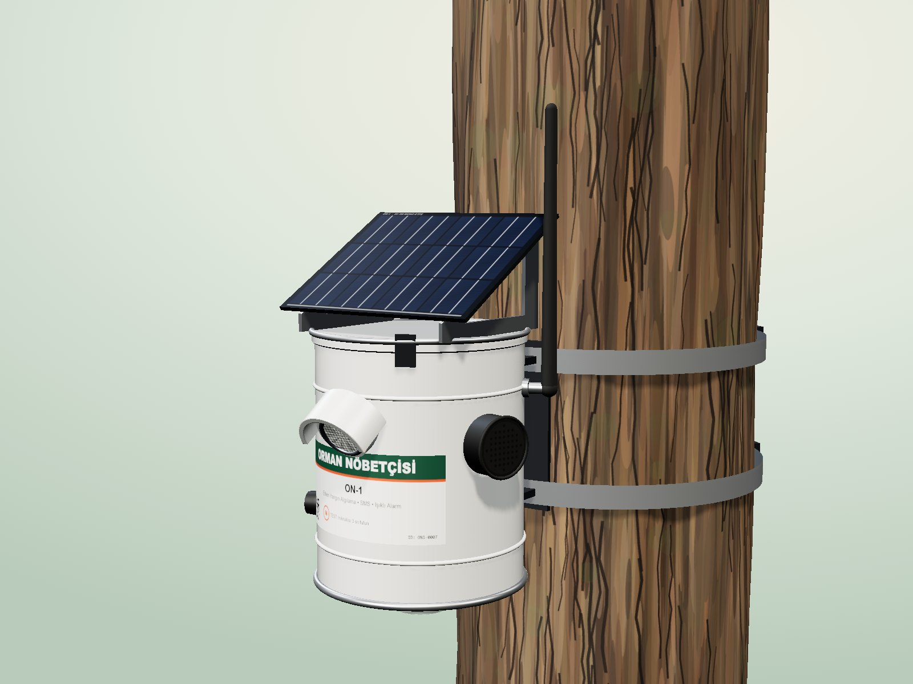

# Orman Nöbetçisi ON-1

Güneş enerjili, teneke gövdeli, ağaca asılan **erken orman yangını algılama düğümü**.
Termal kamera (AMG8833) + gaz/duman (BME680) + sıcaklık/nem verilerini birleştirerek yangını doğrular,
**5 numaraya konumlu SMS** gönderir ve bulunduğu yerde **kırmızı strob + 105 dB siren** ile alarm verir.



## Klasör yapısı

| Yol | İçerik |
|---|---|
| [`SPEC.md`](SPEC.md) | **Tek doğru kaynak**: pin haritası, parça değerleri, güç bütçesi, algoritma, SMS komutları |
| [`hardware/`](hardware/) | Devre şeması (SVG/PNG/PDF), blok diyagram, `BOM.csv`, bağlantı listesi, mekanik çizim, üretici scriptler |
| [`firmware/`](firmware/) | Arduino kaynak kodu (`OrmanNobetcisi/`), birim testleri, kurulum ve komut kılavuzu |
| [`web/`](web/) | Tanıtım sitesi (`index.html`), etkileşimli 3B model (`assets/js/on1-3d.js`), render sayfası |
| [`renders/`](renders/) | 3B ürün görselleri (1600×1200 PNG) |
| [`docs/`](docs/) | Broşür ve teknik doküman kaynakları; PDF'ler `docs/out/` altında |
| [`build.sh`](build.sh) | Render → görseller → teknik doküman → PDF → web indirme dosyaları |

## Hızlı başlangıç

**Siteyi açmak:** `web/index.html` dosyasını tarayıcıda açın (3B model CDN'den Three.js yükler, internet gerekir)
ya da yerel sunucu ile:

```bash
python -m http.server 5077 --directory OrmanNobetcisi
```

ardından `http://localhost:5077/web/` adresine gidin.

**Tüm çıktıları yeniden üretmek** (Chrome + Python gerekir):

```bash
./OrmanNobetcisi/build.sh
```

**Firmware:** derleme, yükleme ve ilk kurulum adımları için [`firmware/README.md`](firmware/README.md).

## Sistem özeti

- **MCU:** ATmega328P 8 MHz / 3,3 V (Arduino Pro Mini uyumlu), WDT ile 8 sn'de bir uyanma
- **Modem:** SIMCom A7670E LTE Cat-1 + GSM yedek, harici 3 dBi anten (teneke Faraday kafesi)
- **Sensörler:** AMG8833 8×8 termal (HDPE pencere, 35° aşağı), BME680 (ePTFE membran), kurcalama, mıknatıslı test
- **Enerji:** 6 V 3 W panel → CN3791 MPPT → 2×18650 (7000 mAh); ort. ≈ 2,3 mA, ≥ 60 gün güneşsiz
- **Alarm:** 6 × 1 W kırmızı LED strob (AO3400A) + MT3608 12 V boost → 105 dB siren
- **Gövde:** Ø153 × 178 mm kalaylı sac, RAL 9010 beyaz, IP54; paslanmaz ağaç kelepçesi

## Doğrulama durumu

| Öğe | Durum |
|---|---|
| Firmware derlemesi (arduino-cli, `arduino:avr:pro` 8 MHz) | bkz. `docs/teknik/firmware_build.txt` |
| Saf mantık birim testleri (skor, Angström, komut çözümleme, CRC) | bkz. `firmware/test/` |
| Donanım prototipi, saha yangın testi, EMC/RED testleri | **Yapılmadı** — teknik dokümandaki test planına göre pilot aşamasında |

> Algılama menzili (1 m² alev için 25–30 m) ve güneşsiz çalışma süresi **hesaplanmış** değerlerdir; saha testleriyle doğrulanmalıdır.
